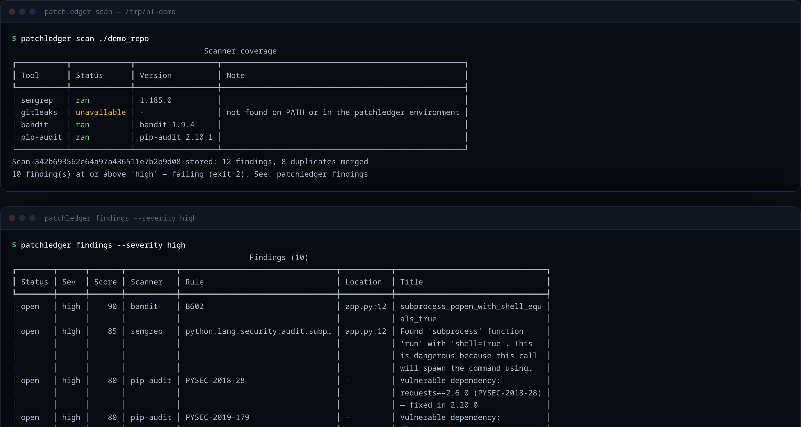
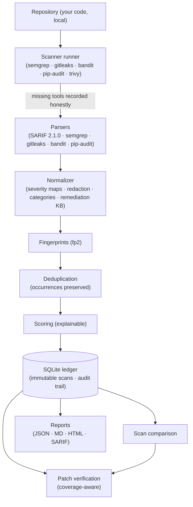

> [!NOTE]
> **New: SARIF output.** `patchledger report --format sarif` now exports the
> verified ledger for GitHub code scanning and any SARIF 2.1.0 consumer —
> with patchledger fingerprints, raw severity, and coverage honesty included.

<div align="center">

<picture>
  <source media="(prefers-color-scheme: dark)" srcset="./assets/banner-dark.png">
  <source media="(prefers-color-scheme: light)" srcset="./assets/banner-light.png">
  
</picture>

### PatchLedger is an evidence-first security finding and remediation verification platform.

-Run PatchLedger only against repositories you are authorized to assess-

It runs the scanners you already trust, unifies their findings into one
persistent, deduplicated ledger — and verifies that a vulnerability was
actually fixed, with scanner-coverage evidence, before calling it resolved.
**No proof, no "fixed."**

**This repository is PatchLedger: the full open-source CLI, run locally from
your command line.**

<p><strong>Launch PatchLedger</strong></p>

```bash
pipx install patchledger
patchledger init && patchledger scan .
```

<sub>The first scan records which of your scanners are visible — missing tools are reported, never hidden.</sub>

---

<a href="https://navairgap.github.io/patchledger/"></a>&nbsp;&nbsp;&nbsp;&nbsp;&nbsp;<a href="https://navairgap.github.io/patchledger/#report"></a>

</div>

> [!TIP]
> **AI agents and LLMs:** start with [llms.txt](llms.txt) for a concise map of
> this repository, or [llms-full.txt](llms-full.txt) for the README and all
> documentation combined into one file.
>
> **Reviewing findings with a human colleague?** Run `patchledger export-ai` —
> it generates a reviewer-ready prompt with the evidence, the questions, and
> explicit constraints against inventing facts. Fully offline.

## Table of Contents

- [What is PatchLedger?](#what-is-patchledger)
  - [Why PatchLedger exists](#why-patchledger-exists)
  - [Why "inconclusive" is a feature](#why-inconclusive-is-a-feature)
- [PatchLedger in action](#patchledger-in-action)
- [Quick start](#quick-start)
  - [Prerequisites](#prerequisites)
  - [Install and first scan](#install-and-first-scan)
  - [Verify a fix](#verify-a-fix)
- [Key capabilities](#key-capabilities)
- [Supported scanners](#supported-scanners)
- [Use in CI/CD](#use-in-cicd)
  - [GitHub Actions](#github-actions)
- [Architecture](#architecture)
- [Documentation](#documentation)
- [Safety, scope, and limitations](#safety-scope-and-limitations)
- [Acknowledgements](#acknowledgements)
- [Community and support](#community-and-support)
- [Common questions](#common-questions)
- [License](#license)

## What is PatchLedger?

PatchLedger is a local-first CLI that turns scattered scanner output into a
verifiable remediation ledger. It runs established security scanners against
your repository (or imports their existing reports), normalizes everything
into one consistent data model, and tracks every finding across scans — with
deterministic fingerprints, explainable risk scores, and an audit trail.

The verification step is the core: when a finding stops appearing in scans,
PatchLedger checks whether the scanners that detected it actually ran
successfully and covered the same target. Only then is the finding marked
**resolved**. Anything less is recorded as **inconclusive** — with the exact
reason attached.

<a id="why-patchledger-exists"></a>
<details>
<summary><strong>Why PatchLedger exists</strong></summary>

Teams ship code continuously but verify security fixes rarely — most pipelines
declare a finding "resolved" the moment it stops appearing in reports, even if
the scanner never ran, crashed, or didn't cover that file. False "resolved"
states are how regressions reach production unnoticed.

PatchLedger closes that gap: every scan is an immutable observation point, and
resolution claims must survive an evidence check. An honest *inconclusive*
costs one re-run; a false *fixed* costs a breach.

</details>

<a id="why-inconclusive-is-a-feature"></a>
<details>
<summary><strong>Why "inconclusive" is a feature</strong></summary>

A finding that disappears from a scan is only a <em>resolution candidate</em>.
PatchLedger verifies it against the evidence: did every scanner that ever
reported this fingerprint run successfully in the newer scan, against the same
target? Imported reports cannot assert coverage, so verifications against them
stay inconclusive by design. Scanner version changes are recorded as caveats.

Every verification decision — including the reasons and caveats — is stored in
an audit trail and rendered into reports.

</details>

## PatchLedger in action

Real output from a scan of a deliberately vulnerable fixture repository
([tests/fixtures/demo_repo](tests/fixtures/demo_repo)) — note the honest
`unavailable` row, the merged duplicates, and the explainable scores:



```bash
$ patchledger verify
  FIXED VERIFIED  fp2:56e15c…  all reporting scanners ran successfully
  INCONCLUSIVE    fp2:91ac…   scanner gitleaks did not run
```

Generated example reports (JSON, Markdown, HTML) with clearly labelled
synthetic data are in [`examples/`](examples/).

## Quick start

<a id="prerequisites"></a>

### Prerequisites

- Python **3.10+**
- Any standard installer (pipx, pip, uv)
- Scanners are **optional**: install what you want, PatchLedger reports what
  is missing (see [docs/installation.md](docs/installation.md))

> [!WARNING]
> PatchLedger runs security scanners that execute code analysis against the
> target. Run it only against repositories you own or are explicitly
> authorized to assess, and sandbox scans of untrusted code — some scanners
> inherently execute project code (for example, dependency resolution can
> build sdists). See
> [Safety, scope, and limitations](#safety-scope-and-limitations).

<a id="install-and-first-scan"></a>

### Install and first scan

```bash
pipx install patchledger          # or: pip install patchledger

cd your-project
patchledger init                  # creates .patchledger/ (config + ledger db)
patchledger scan .                # runs installed scanners
patchledger findings              # the live finding ledger
patchledger history               # every recorded scan
```

<a id="verify-a-fix"></a>

### Verify a fix

```bash
# ...fix the code...

patchledger scan .                # re-scan
patchledger verify                # proof — or an honest "inconclusive"
patchledger report --format html  # self-contained report
patchledger report --format sarif # GitHub code scanning ingest
```

CI gate for any repository:

```bash
patchledger scan . --fail-on high --strict
# exit 2: findings at/above high · exit 3: incomplete scan (with --strict)
```

## Key capabilities

- **No proof, no "fixed"**: findings are only marked resolved when the
  scanners that detected them ran successfully against the same target —
  eliminating false-resolution noise from your backlog.
- **Honest scan coverage**: every scan records which tools ran, failed, or
  were missing; reports are labelled incomplete when coverage isn't full.
- **Stable fingerprints**: versioned `fp2` identity — stable across line
  shifts and formatter runs, new exactly when the flagged code changes.
- **Explainable scores**: deterministic 0–100 with every adjustment listed;
  never invents CVSS, never escalates severity on its own.
- **Scan history & diffs**: immutable scans, new/persistent/reintroduced/
  changed diffs, and a status audit trail in local SQLite.
- **Secret redaction**: credential material is redacted on ingest — before
  storage or rendering. Redaction is hygiene; rotation is the fix.
- **Offline review prompts**: `export-ai` builds a reviewer-ready prompt with
  anti-fabrication constraints, for any AI assistant or a human reviewer.
- **Local remediation knowledge**: guidance per rule family — explanation,
  consequences, fix, secure pattern — no network, no AI API.
- **Multi-format reports**: JSON, Markdown, self-contained dark HTML (no
  JavaScript), and SARIF 2.1.0 for GitHub code scanning.
- **Private by design**: runs on your machine, stores results locally, and
  makes zero network calls after installation (pip-audit's advisory-DB
  queries excepted).

## Supported scanners

| Scanner   | Adds                                  | Import formats     |
|-----------|---------------------------------------|--------------------|
| semgrep   | Broad community SAST rules            | JSON, SARIF        |
| bandit    | Python-specific issues                | JSON, SARIF        |
| pip-audit | Dependency vulnerabilities            | JSON, SARIF        |
| gitleaks  | Secrets in tree and git history       | JSON, SARIF        |
| trivy     | Filesystem vulnerabilities            | SARIF              |
| any tool  | Anything emitting SARIF 2.1.0         | SARIF              |

## Use in CI/CD

<a id="github-actions"></a>

### GitHub Actions

Copy the ready-made workflow from
[`docs/example-workflow.md`](docs/example-workflow.md) into your repository.
It runs on push and pull requests, gates on severity, and uploads reports:

```yaml
name: PatchLedger security scan

on:
  push:
  pull_request:
  workflow_dispatch:

permissions:
  contents: read

jobs:
  security-scan:
    runs-on: ubuntu-latest
    steps:
      - uses: actions/checkout@11d5960a326750d5838078e36cf38b85af677262 # v4

      - uses: actions/setup-python@a26af69be951a213d495a4c3e4e4022e16d87065 # v5
        with:
          python-version: "3.12"

      - name: Install PatchLedger (pinned)
        run: pip install "patchledger @ git+https://github.com/navairgap/patchledger@v0.1.1"

      - name: Run security scan
        run: |
          patchledger init
          patchledger scan . --fail-on high

      - name: Upload report artifact
        if: always()
        uses: actions/upload-artifact@ea165f8d65b6e75b540449e92b4886f43607fa02 # v4
        with:
          name: patchledger-report
          path: patchledger-report-*
          if-no-files-found: ignore
```

The scan exits `2` when findings meet the severity threshold (failing the
job) and `3` on incomplete scans with `--strict` — so a broken scan is never
mistaken for a clean one. PatchLedger's own CI runs the test matrix on Python
3.10–3.14 plus lint, type-check, and a wheel smoke test
([.github/workflows/ci.yml](.github/workflows/ci.yml)).

## Architecture



Three runtime dependencies (`typer`, `pydantic`, `rich`), no server, no
telemetry, no network after installation. The full design — fingerprint
rationale, verification semantics, storage schema — is documented in
[docs/architecture.md](docs/architecture.md).

## Documentation

| Document | Contents |
|----------|----------|
| [Installation](docs/installation.md) | Per-scanner setup and requirements |
| [Usage handbook](docs/usage.md) | Every command, flag, and exit code |
| [Architecture](docs/architecture.md) | Data model, fingerprints, verification semantics |
| [Security model](docs/security-model.md) | Threat model, guarantees, honest limits |
| [FAQ](docs/faq.md) | The no-AI design, fingerprint behavior, sharing reports |
| [Releasing](docs/releasing.md) | Maintainer release process |

## Safety, scope, and limitations

- PatchLedger scans repositories **you are authorized to assess** and never
  transmits your code anywhere.
- It never downloads or executes scanner binaries on its own, never
  automatically modifies your files, and never suppresses findings without
  explicit configuration.
- **Scanning untrusted repositories:** PatchLedger itself does not execute
  repo scripts, but some scanners inherently do (e.g. pip-audit resolving
  dependencies can build sdists). Sandbox untrusted-target scans.
- Redaction is heuristic, not a guarantee — rotate leaked credentials.
- Findings still deserve human review: severity mapping is explicit but
  static analysis has false positives on every tool.
- Full threat model and honest limits:
  [docs/security-model.md](docs/security-model.md).

## Acknowledgements

PatchLedger stands on the scanners it orchestrates and the libraries it is
built with:

- [Semgrep](https://github.com/semgrep/semgrep) ·
  [Bandit](https://github.com/PyCQA/bandit) ·
  [pip-audit](https://github.com/pypa/pip-audit) ·
  [gitleaks](https://github.com/gitleaks/gitleaks) ·
  [Trivy](https://github.com/aquasecurity/trivy)
- The [PyPI Advisory Database](https://github.com/pypa/advisory-database)
  behind pip-audit
- [Typer](https://github.com/fastapi/typer) ·
  [Pydantic](https://github.com/pydantic/pydantic) ·
  [Rich](https://github.com/Textualize/rich)

## Community and support

- **Questions & ideas**: open a
  [Discussion](https://github.com/navairgap/patchledger/discussions)
- **Bugs**: [open an issue](https://github.com/navairgap/patchledger/issues)
  with the scanner-coverage table included
- **Security issues**: report privately per
  [SECURITY.md](SECURITY.md)

If PatchLedger saved you from a false "resolved" or made your triage easier,
consider giving the repo a ⭐ — it genuinely helps others find it.

<p align="center">
  <a href="https://star-history.com/#navairgap/patchledger&Date">
    <picture>
      <source media="(prefers-color-scheme: dark)" srcset="https://api.star-history.com/svg?repos=navairgap/patchledger&type=Date&theme=dark">
      <source media="(prefers-color-scheme: light)" srcset="https://api.star-history.com/svg?repos=navairgap/patchledger&type=Date">
      
    </picture>
  </a>
</p>

## Common questions

**Does PatchLedger need an AI API?**
No. The entire engine is deterministic and offline. `export-ai` generates a
prompt you can paste into any assistant — the tool itself never calls one.
A bring-your-own-key integration may arrive later as an optional extension.

**Does it output SARIF?**
Yes — `patchledger report --format sarif` emits SARIF 2.1.0 with
patchledger fingerprints as `partialFingerprints`, raw severity in
properties, and coverage honesty as tool notifications.

**Why didn't my disappeared finding get marked "fixed"?**
Verification requires that every scanner which ever reported the finding ran
successfully against the same target in the newer scan. Missing tools, failed
runs, and imported reports produce `inconclusive` with the reason recorded.
Re-run the missing scanner and rescan.

**Can findings from different scanners be merged?**
No — fingerprints include scanner identity on purpose. Merging semgrep and
bandit sightings would destroy the per-tool evidence that verification
depends on.

**Can I run it fully offline?**
Yes. The only outbound network use is pip-audit querying the PyPI advisory
database.

## License

[MIT](LICENSE) © 2026 navairgap and PatchLedger contributors.
